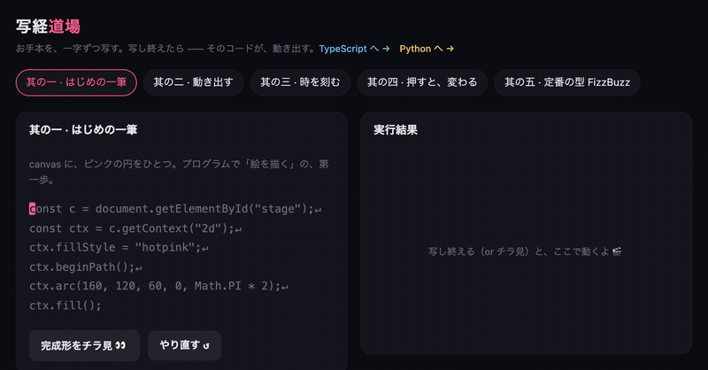
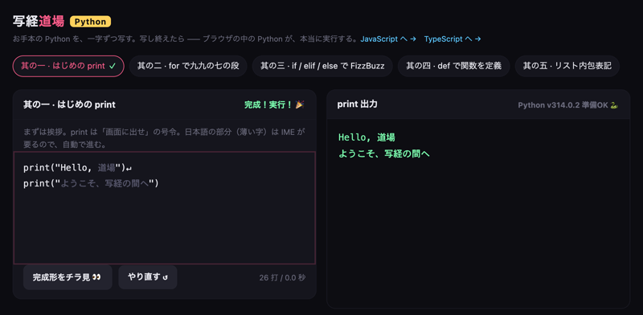

# 写経道場 — Shakyo Dojo

お手本のコードを、**一字ずつ写す**。写し終えると —— そのコードが、動き出す。

写経は本来、経典を一字ずつ書き写す修行のこと。それをコードでやります。
読んだだけでは指が覚えない構文を、1文字ずつ通す。最後の1文字を打った瞬間に
実際に実行され、円が描かれ、ボールが跳ね、時計が動き出します。



**▶ その場で試す: https://npulsar-droid.github.io/shakyo-dojo/**

**単一HTMLファイル・依存ゼロ・ビルド不要。** ダウンロードしてダブルクリックでも動きます。

## 3つの道場

| ファイル | 言語 | 実行方法 |
|---|---|---|
| `index.html` | JavaScript | サンドボックス iframe（canvas / DOM / setInterval） |
| `ts.html` | TypeScript | 型注釈を除去して JS として実行。除去後のコードも並べて表示 |
| `py.html` | Python | [Pyodide](https://pyodide.org/) でブラウザ内実行（初回のみ CDN から読み込み） |

各5題、計15題。JS は「円を描く → 動かす → 時を刻む → イベント → FizzBuzz」、
TS は「型を名乗る → interface → union → ジェネリクス → enum」、
Py は「print → for → if/elif → def → リスト内包表記」。

Python も、サーバなしで**本当に実行されます**（Pyodide が WebAssembly で動かしています）。



## 使い方

コード欄をクリックして、表示されているお手本をそのままタイプするだけです。

- 合っている文字だけが進みます。違う文字を打つと赤く光って**進みません**
- インデントや改行は自動で送られるので、行頭のスペースを数える必要はありません
- 打ち終わると自動で実行され、右側に結果が出ます

タイプ練習ではなく写経なので、速度は測りません。詰まった箇所が、
自分がまだ読めていない構文です。

## 動かす

そのまま開くだけです。

```bash
open index.html
```

ローカルサーバ経由でも動きます（`py.html` を含め、どちらでも可）。

```bash
python3 -m http.server 8349
```

## 技術

- 実行: JS/TS は `iframe` の `srcdoc`、Python は Pyodide（WebAssembly）
- TypeScript の型除去は正規表現ベースの簡易実装（`stripTypes()`）。
  完全なコンパイラではなく、収録している課題の範囲で動くもの
- 保存: 完了した課題だけを localStorage に記録（打った内容は保存しません）
- 外部ライブラリなし（Pyodide のみ CDN）

## ライセンス

MIT
